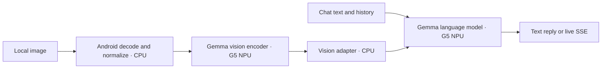

# Local image understanding — milestone 6

Gemma accepts images and answers with **text** through the existing chat UI and
`POST /v1/chat/completions`, including live SSE. The already selected
`gemma-4-E2B-it_Google_Tensor_G5.litertlm` contains the vision models; no additional
model download or GPU library is needed. The LiteRT-LM/LiteRT/NDK pins stay the
same as the verified language path. Image generation remains future work.

## Measured accelerator arrangement

On the reference Pixel 10 / GrapheneOS, both **language generation and the
vision encoder use Tensor G5 NPU dispatch**. The vision adapter and image
decoding/normalization use CPU. The existing sherpa ASR/TTS engines remain
independent CPU engines.



The runtime option alone does **not** establish the encoder's accelerator.
The pinned vision executor is configured with `Backend::CPU`, which selects
CPU execution for ordinary ops. The G5 encoder is already compiled: its
`vision_70`, `vision_140`, and `vision_280` subgraphs each contain one
`DISPATCH_OP`. LiteRT applies its dispatch delegate to these AOT graphs even
with that CPU option. The adapter's corresponding subgraphs contain ordinary
builtin operators and run with CPU/XNNPACK options.

The app inspects both sets of graphs at load time and rejects a package that
does not match this arrangement. Physical verification observed encoder-load
SouthBound/async dispatch delegate initialization, an actual vision execution
benchmark, and correct responses to distinct images. Merely observing a loaded
vendor library would not establish this result. See
[the pinned vision executor](https://github.com/google-ai-edge/LiteRT-LM/blob/0b98b80e1d846af27d10b8ab395645119cb231e4/runtime/executor/vision_litert_compiled_model_executor.cc),
[LiteRT compiled model loading](https://github.com/google-ai-edge/LiteRT/blob/43d8b4f20ef743a7c5beb69c365538e726cc20d9/litert/runtime/compiled_model.cc),
and [device verification](milestone-verification.md).

## Why the vision adapter uses CPU

The adapter's CPU execution follows the support available in this pinned
runtime and model package. In
[`VisionAdapter::Initialize()` at the pinned commit](https://github.com/google-ai-edge/LiteRT-LM/blob/0b98b80e1d846af27d10b8ab395645119cb231e4/runtime/executor/vision_litert_compiled_model_executor.cc#L298-L345),
the `Backend::NPU` branch also selects `litert::HwAccelerators::kCpu`.
Changing the vision backend flag alone would therefore leave this package's
builtin adapter operations on CPU.

**No CPU-versus-NPU adapter benchmark has been performed on the reference
Pixel 10.** The graph checks and device observations establish the current
execution arrangement. They do not establish that CPU is faster. The recorded
`vision_executor` timing covers the combined vision path, rather than an
isolated adapter comparison.

CPU is not always faster for a vision adapter. For a small workload, accelerator
submission, synchronization, and data transfers can outweigh the time saved
by NPU computation. An NPU could be faster with enough parallel computation
or a pipeline that keeps data on the accelerator. These are possible tradeoffs;
the adapter's 15 operators per variant alone do not determine its cost.
[LiteRT's delegate documentation](https://developers.google.com/edge/litert/performance/implementing_delegate)
explains how transfers between execution stages can offset acceleration gains.

A valid comparison would require a working G5 NPU adapter and runtime support,
with actual NPU execution verified. Both implementations should use the same
inputs and corresponding 70/140/280-token variants, measure adapter execution
and the complete image-to-answer pipeline, and report initialization separately
from repeated warm requests.

## Use the app

1. Select the existing G5 model, or reuse its saved selection.
2. Tap **Attach image** and select a local PNG, JPEG, or WebP still image with
   Android's document picker. The selected document URI appears below the prompt.
3. Enter a prompt such as “Describe the shape and color” or “Transcribe the
   printed text,” then tap **Run**. Image-only input is also accepted.
4. **Clear image** returns to text-only requests. The image selection survives
   Activity recreation but is not stored as a persistent preference on a fresh
   launch. A selected document is read anew for each UI request.

Reading, decoding, normalization, and generation run on the engine worker,
away from the main thread. Image requests use the same foreground service,
admission gate, cancellation, and unload controls as text chat. No camera or
broad photo/storage permission is needed.

## Chat API subset

Use the existing chat model ID. User message content can mix ordered text and
`image_url` parts. Images in earlier user turns are supported when the full
conversation is supplied again; assistant/system/developer turns remain text.
The server retains the engine, and starts a fresh conversation for each request.

```json
{
  "model": "gemma-4-E2B-it_Google_Tensor_G5",
  "messages": [{
    "role": "user",
    "content": [
      {"type": "text", "text": "Describe the shape and color."},
      {"type": "image_url", "image_url": {
        "url": "data:image/png;base64,<base64 image bytes>",
        "detail": "auto"
      }}
    ]
  }],
  "max_tokens": 128,
  "stream": false
}
```

Replace the placeholder with actual padded base64. This follows the
[OpenAI chat image content structure](https://developers.openai.com/api/reference/resources/chat),
with an intentionally bounded local subset:

| Input | Accepted |
| --- | --- |
| Image format | Still PNG, JPEG, WebP; MIME must match the decoded format |
| `image_url.url` | `data:image/png;base64,...`, `data:image/jpeg;base64,...`, or `data:image/webp;base64,...` |
| `image_url.detail` | `auto` or omitted; `low`, `high`, and other values return 400 |
| Image count | At most 4 across all user turns in the request; UI selects one |
| Source image size | At most 2 MiB each, 4 MiB total, before base64 encoding |
| Source dimensions | At most 16,000,000 pixels, and 8192 pixels on either side |
| Normalized dimensions | Aspect ratio preserved; longest side at most 1024 pixels |
| Chat JSON body | At most 6 MiB including base64; conversation text at most 256 KiB |
| Messages/content parts | 1–128 messages, 1–256 parts per array; last turn must be user |

Remote HTTP(S) URLs, filesystem paths, and `content://` URLs in API requests
return 400, code `invalid_image`. The server makes no outbound image fetches.
The app's trusted UI can read its own explicitly selected SAF document.
Malformed base64, incomplete/corrupt images, MIME mismatches, unsupported
formats, and animated images detected by Android also return 400. Image size/count/
dimension excesses return 413 (`image_too_large`); the overall JSON/text cap
uses `request_too_large`. Invalid API image inputs are rejected before loading
or generating with the model.

Set `stream: true` to receive the same text delta SSE contract as ordinary chat.
Usage comes from upstream prefill/decode measurements and includes the visual
prompt tokens; InferDroid does not estimate them from image bytes. The pinned
package's default Gemma patch budget selects a supported encoder/adapter
signature; the API does not expose cloud image-detail modes or custom budgets.

## Host example

Start the local server and configure the key as in [local-api.md](local-api.md).
With a loopback ADB forward on host port 18080:

```python
import base64, json, os, urllib.request
from pathlib import Path

image = base64.b64encode(Path("example.png").read_bytes()).decode("ascii")
body = {
    "model": "gemma-4-E2B-it_Google_Tensor_G5",
    "messages": [{"role": "user", "content": [
        {"type": "text", "text": "Read the printed text in this image."},
        {"type": "image_url", "image_url": {
            "url": "data:image/png;base64," + image
        }}
    ]}],
    "max_tokens": 128
}
request = urllib.request.Request(
    "http://127.0.0.1:18080/v1/chat/completions",
    data=json.dumps(body).encode("utf-8"),
    headers={"Authorization": "Bearer " + os.environ["INFERDROID_API_KEY"],
             "Content-Type": "application/json"}
)
with urllib.request.urlopen(request, timeout=120) as response:
    print(json.load(response)["choices"][0]["message"]["content"])
```

## Image lifetime and limits of verification

Android `ImageDecoder` validates dimensions before allocating the resized
bitmap, applies EXIF orientation, rejects partial decoding, and uses software
bitmaps. Transparency is flattened on white. The bitmap is re-encoded as PNG
without original metadata so LiteRT's native preprocessor receives a known
codec and bounded dimensions. Bitmap resources and document streams close even
on failures.

Only in-memory normalized PNG blobs cross the JNI boundary as LiteRT-LM
`{"type":"image","blob":"..."}` attachments. The API never passes a client
path to native code. There are no temporary image files to clean up; attachment
references leave scope after the request and native callbacks drain. Clearing
the UI selection removes the selected URI. Full unload releases the encoder
and adapter along with the language engine and its model mappings.

The device checks used code-generated colored shapes and “HELLO 42,” not
private photographs. They establish real image input, text reading, multiple
images, history, and streaming. They are not a broad vision accuracy benchmark:
some answers correctly named the shape/text but incorrectly described the text
color or placement. Resizing and the model's visual token budget can lose fine detail.
